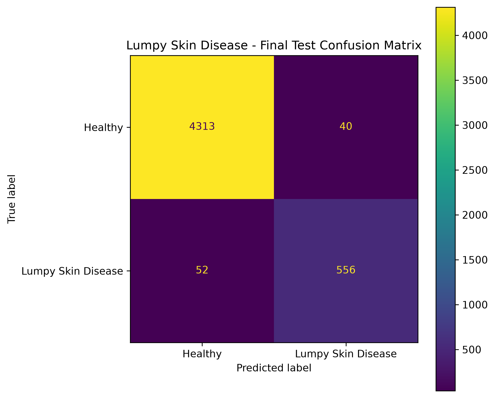

<div align="center">

# LSD Risk Studio

**Machine-learning risk screening for Lumpy Skin Disease (LSD), built on climate, terrain and livestock-density data.**

[**Live demo**](https://lumpy-skin-disease-ml.streamlit.app/) · [Report an issue](https://github.com/AbdelrhmanAkl/lumpy-skin-disease-ml/issues)

[](https://www.python.org/)
[](https://xgboost.readthedocs.io/)
[](https://scikit-learn.org/)
[](https://streamlit.io/)
[](https://lumpy-skin-disease-ml.streamlit.app/)


</div>

---

## Why this project

Lumpy Skin Disease is a viral cattle disease that spreads with climate, insect vectors and animal density. Surveillance teams need a fast way to ask: *do the conditions at this location look like places where outbreaks have happened?*

LSD Risk Studio answers that question in seconds. You enter a location's conditions, or upload a file with many locations, and get a risk percentage with a plain-language level.

> **Important:** This is a decision-support prototype for education, research and portfolio use. It is **not** a veterinary diagnostic tool. See [Responsible use](#responsible-use).

---

## Highlights

| | |
|---|---|
| **Live risk score** | The score updates as you change any input. No submit button. |
| **Three risk levels** | Low (below 30%), Moderate (30–60%), High (above 60%), each with a short recommendation. |
| **Explainable output** | Shows the top factors that raised or lowered the score for that specific input (XGBoost SHAP-style contributions). |
| **Example locations** | One-click starting points so a new user is never staring at empty fields. |
| **Batch analysis** | Upload a CSV, get a risk score per row, see locations on a map, download the results. |
| **CSV template** | Download a ready-made file with the correct columns. |
| **Validated input** | Clear messages for missing columns and empty or non-numeric values. |

<div align="center">

</div>

---

## Model performance

Evaluated once on a held-out test set that was not used for model selection.

| Metric | Score |
|---|---:|
| Accuracy | **98.15%** |
| F1 score | **92.36%** |
| ROC-AUC | **99.30%** |

The gap between accuracy and F1 suggests the classes are imbalanced, so F1 and ROC-AUC are the more informative numbers. See [Limitations](#limitations) for how to read these results.

<div align="center">

</div>

---

## The machine-learning task

- **Type:** binary classification
- **Target:** `0` Healthy, `1` Lumpy Skin Disease
- **Final model:** XGBoost, stored in `models/lumpy_skin_model.joblib`
- **Inputs:** 16 numerical features, in a fixed order

### Input features

| Group | Feature | Meaning |
|---|---|---|
| Location | `x` | Longitude |
| | `y` | Latitude |
| | `elevation` | Elevation above sea level |
| | `dominant_land_cover` | Land-cover class code |
| Climate | `tmp`, `tmn`, `tmx` | Mean, minimum and maximum temperature |
| | `dtr` | Diurnal temperature range |
| | `pre` | Precipitation |
| | `wet` | Wet days |
| | `cld` | Cloud cover |
| | `vap` | Vapour pressure |
| | `pet` | Potential evapotranspiration |
| | `frs` | Frost days |
| Livestock | `X5_Ct_2010_Da` | Cattle density |
| | `X5_Bf_2010_Da` | Buffalo density |

The model expects these exact names and this exact order. The order is stored in `artifacts/feature_names.json` and loaded by the app.

---

## Evaluation workflow

```text
Dataset → Preparation → Train / Validation / Test split
                              │
                 Validation ──┴── Model selection
                                        │
                              Final test evaluation (once)
                                        │
                                 Saved model + metrics
                                        │
                                  Streamlit app
```

The test set stays untouched during model and hyperparameter selection. After selection, the model may be refit on train + validation with the chosen hyperparameters and evaluated once on the test set.

---

## Using the app

### Check a location
1. Pick an example location or choose **Custom values**.
2. Adjust location, climate and livestock values.
3. Read the risk gauge, the risk level and the factors behind the score.

### Check a file
1. Download the CSV template.
2. Fill in one row per location with all 16 features.
3. Upload it, review the summary and the map, then download the results.

Output columns added to your file: `risk_percent` and `risk_level`.

---

## Project structure

```text
lumpy-skin-disease-ml/
├── app.py                  # Streamlit application
├── train.py                # Training and evaluation pipeline
├── predict.py              # Prediction utilities
├── requirements.txt
├── data/
│   └── Lumpy skin disease data.csv
├── models/
│   └── lumpy_skin_model.joblib
├── artifacts/
│   ├── metrics.json
│   ├── feature_names.json
│   └── confusion_matrix.png
├── notebooks/
│   └── Final_Project_Lumpy_Skin_Disease_data_Classification__.ipynb
├── docs/
│   └── screenshots/
└── .streamlit/
    └── config.toml
```

---

## Run it locally

```bash
git clone https://github.com/AbdelrhmanAkl/lumpy-skin-disease-ml.git
cd lumpy-skin-disease-ml

python -m venv .venv
# Windows:      .venv\Scripts\activate
# macOS/Linux:  source .venv/bin/activate

pip install -r requirements.txt
streamlit run app.py
```

Use the same `scikit-learn` and `xgboost` versions that were used for training, otherwise the saved model may fail to load.

### Retrain the model

```bash
python train.py
```

This regenerates `models/lumpy_skin_model.joblib` and the files in `artifacts/`. When retraining, keep the target definition, feature names, feature order and split methodology consistent with the app.

---

## Tech stack

Python · pandas · NumPy · scikit-learn · XGBoost · joblib · Streamlit · Matplotlib · Jupyter

---

## Limitations

- **Environmental conditions, not animals.** The model scores places, not individual cattle.
- **Class imbalance.** Accuracy alone can look better than real-world performance.
- **Spatial leakage risk.** Nearby locations in the dataset share similar conditions. A random split can overestimate performance on new regions, so geographic cross-validation is needed before trusting the scores elsewhere.
- **Static livestock data.** Cattle and buffalo densities are from 2010.
- **Uncalibrated probabilities.** The percentage is a model score, not a calibrated chance of infection.
- **Illustrative examples.** The example locations in the app are not real surveillance records.

## Responsible use

Intended for academic demonstration, machine-learning research, portfolio development and decision-support experiments.

It must not replace veterinary diagnosis, laboratory testing, professional epidemiological assessment or official animal-health guidance.

## Roadmap

- [ ] Geographic cross-validation and external validation
- [ ] Probability calibration
- [ ] Automatic climate and elevation lookup from a map click
- [ ] Per-prediction SHAP explanations for any model type
- [ ] FastAPI backend with a custom web frontend
- [ ] Automated input-data validation and drift monitoring

---

## Author

**Abdelrahman Akl** · Machine Learning / AI

[GitHub](https://github.com/AbdelrhmanAkl)

## License

Released for educational, academic and portfolio purposes. Add a license file (for example MIT) if you want others to reuse the code.
