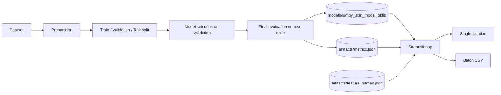

# LSD Risk Studio

**Machine-learning risk screening for Lumpy Skin Disease, built on climate, terrain and livestock-density data.**

[Live demo](https://lumpy-skin-disease-ml.streamlit.app/) | [Source](https://github.com/AbdelrhmanAkl/lumpy-skin-disease-ml) | [Issues](https://github.com/AbdelrhmanAkl/lumpy-skin-disease-ml/issues)

[](https://www.python.org/)
[](https://xgboost.readthedocs.io/)
[](https://scikit-learn.org/)
[](https://streamlit.io/)
[](#results)

> **Scope:** a decision-support prototype for research, education and portfolio use. It is not a veterinary diagnostic tool. See [Responsible use](#responsible-use).

---

## Contents

1. [At a glance](#at-a-glance)
2. [Problem](#problem)
3. [Results](#results)
4. [Features](#features)
5. [System overview](#system-overview)
6. [Input schema](#input-schema)
7. [Quick start](#quick-start)
8. [Using the app](#using-the-app)
9. [Repository layout](#repository-layout)
10. [Methodology](#methodology)
11. [Limitations](#limitations)
12. [Responsible use](#responsible-use)
13. [Roadmap](#roadmap)

---

## At a glance

| | |
|---|---|
| **Task** | Binary classification: `0` Healthy, `1` Lumpy Skin Disease |
| **Model** | XGBoost |
| **Inputs** | 16 numerical features: location, terrain, climate, livestock density |
| **Output** | Risk percentage and a level: Low, Moderate or High |
| **Interface** | Streamlit web app with live scoring and batch CSV analysis |
| **Test metrics** | Accuracy 98.15%, F1 92.36%, ROC-AUC 99.30% |

---

## Problem

Lumpy Skin Disease is a viral cattle disease whose spread is linked to climate, insect vectors and animal density. Animal-health teams need a fast way to ask a simple question: *do the conditions at this location resemble places where outbreaks have occurred?*

This project answers that question from environmental data alone. A user enters the conditions for one location, or uploads a file with many, and receives a risk score in seconds.

---

## Results

Final evaluation on a held-out test set that was not used for model selection.

| Metric | Score |
|---|---:|
| Accuracy | 98.15% |
| F1 score | 92.36% |
| ROC-AUC | 99.30% |

Accuracy is higher than F1, which points to imbalanced classes. F1 and ROC-AUC are therefore the more informative figures. Read them together with the [Limitations](#limitations), in particular the note on spatial leakage.

---

## Features

| Feature | Description |
|---|---|
| Live scoring | The risk score updates as any input changes. No submit button. |
| Risk levels | Low (below 30%), Moderate (30% to 60%), High (above 60%), each with a short recommendation. |
| Per-prediction explanation | The factors that raised or lowered the score for that specific input, computed from XGBoost tree contributions. Shown when the saved model is a plain XGBoost estimator. |
| Example locations | One-click starting values, so the form is never empty. |
| Batch analysis | Upload a CSV, score every row, view locations on a map, download results. |
| CSV template | A ready-made file with the correct columns in the correct order. |
| Input validation | Clear errors for missing columns and for empty or non-numeric values. |

---

## System overview



The app reads three artifacts at start-up: the trained model, the stored metrics, and the ordered feature list. It builds the model input from the feature list, so the feature order in the app always matches training.

---

## Input schema

The model expects these 16 features, with these exact names, in this order. The order is stored in `artifacts/feature_names.json`.

| Group | Feature | Meaning |
|---|---|---|
| Location | `x` | Longitude |
| | `y` | Latitude |
| | `elevation` | Elevation above sea level |
| | `dominant_land_cover` | Land-cover class code |
| Climate | `tmp` | Mean temperature |
| | `tmn` | Minimum temperature |
| | `tmx` | Maximum temperature |
| | `dtr` | Diurnal temperature range |
| | `pre` | Precipitation |
| | `wet` | Wet days |
| | `cld` | Cloud cover |
| | `vap` | Vapour pressure |
| | `pet` | Potential evapotranspiration |
| | `frs` | Frost days |
| Livestock | `X5_Ct_2010_Da` | Cattle density |
| | `X5_Bf_2010_Da` | Buffalo density |

---

## Quick start

```bash
git clone https://github.com/AbdelrhmanAkl/lumpy-skin-disease-ml.git
cd lumpy-skin-disease-ml

python -m venv .venv
source .venv/bin/activate        # Windows: .venv\Scripts\activate

pip install -r requirements.txt
streamlit run app.py
```

Install the same `scikit-learn` and `xgboost` versions that were used for training. A version mismatch can prevent the saved model from loading.

To retrain the model:

```bash
python train.py
```

This regenerates `models/lumpy_skin_model.joblib` and the files in `artifacts/`.

---

## Using the app

**Check a location**

1. Choose an example location, or keep the custom values.
2. Adjust the location, climate and livestock inputs.
3. Read the risk gauge, the level, and the factors behind the score.

**Check a file**

1. Download the CSV template.
2. Fill in one row per location with all 16 features.
3. Upload the file and review the summary and map.
4. Download the results. Two columns are added: `risk_percent` and `risk_level`.

---

## Repository layout

```text
lumpy-skin-disease-ml/
├── app.py                  Streamlit application
├── train.py                Training and evaluation pipeline
├── predict.py              Prediction utilities
├── requirements.txt
├── data/
│   └── Lumpy skin disease data.csv
├── models/
│   └── lumpy_skin_model.joblib
├── artifacts/
│   ├── metrics.json
│   ├── feature_names.json
│   └── confusion_matrix.png
├── notebooks/
│   └── Final_Project_Lumpy_Skin_Disease_data_Classification__.ipynb
└── .streamlit/
    └── config.toml
```

---

## Methodology

- **Splits.** Data is divided into train, validation and test sets.
- **Selection.** Models and hyperparameters are chosen using validation performance only.
- **Final evaluation.** The test set is used once, after selection. If the chosen model is refit on train plus validation, it is still evaluated a single time on the untouched test set.
- **Consistency.** Target definition, feature names, feature order and the prediction pipeline are kept identical between training and the app.

When retraining, keep those four items unchanged, or update `feature_names.json` and the app together.

---

## Limitations

- **Places, not animals.** The model scores environmental conditions. It does not examine individual cattle.
- **Class imbalance.** Accuracy alone overstates real-world performance. Prefer F1 and ROC-AUC.
- **Spatial leakage.** Nearby records share similar conditions. A random split can overestimate performance in regions the model has not seen. Geographic cross-validation is needed before trusting scores far from the training data.
- **Dated livestock data.** Cattle and buffalo densities are from 2010.
- **Uncalibrated scores.** The percentage is a model score, not a calibrated probability of infection.
- **Illustrative examples.** The example locations in the app are not real surveillance records.

---

## Responsible use

Intended for academic demonstration, machine-learning research, portfolio work and decision-support experiments.

It must not replace veterinary diagnosis, laboratory testing, professional epidemiological assessment or official animal-health guidance.

---

## Roadmap

- [ ] Geographic cross-validation and external validation
- [ ] Probability calibration
- [ ] Automatic climate and elevation lookup from a map location
- [ ] Model-agnostic explanations for any saved model type
- [ ] API backend with a separate web frontend
- [ ] Automated input validation and drift monitoring

---

## Author

**Abdelrahman Akl**, Machine Learning and AI.
[GitHub](https://github.com/AbdelrhmanAkl)

## License

Released for educational, academic and portfolio purposes. Add a license file, for example MIT, if you want others to reuse the code.
